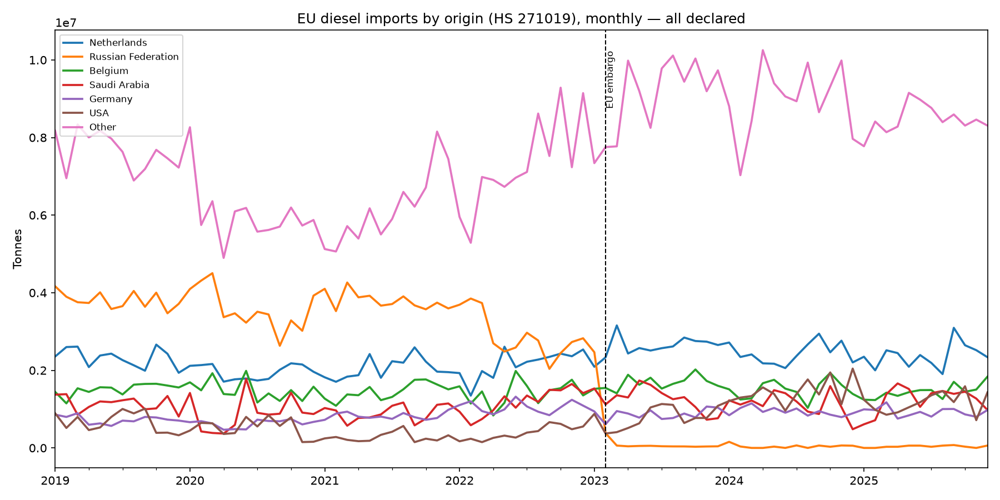
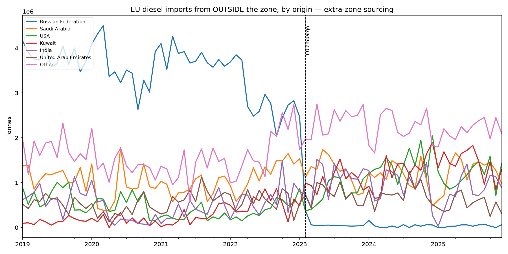
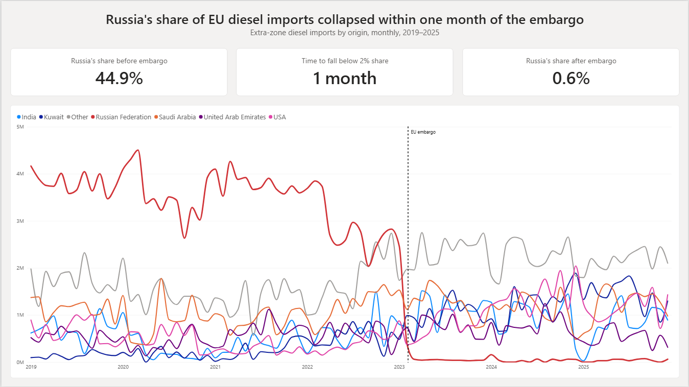
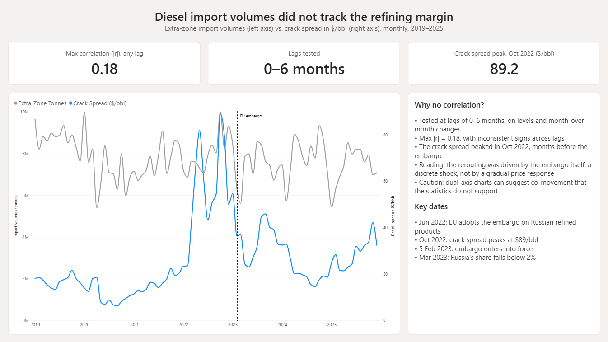
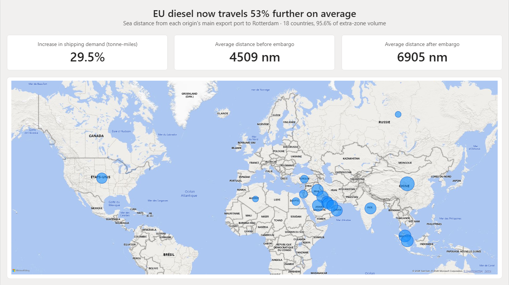
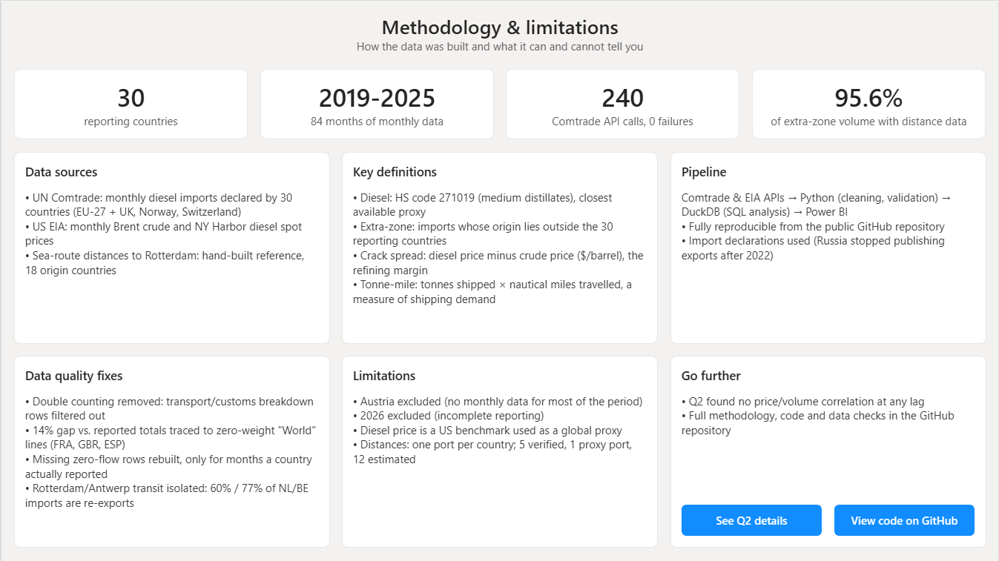

# EU Diesel Rerouting After the Russian Embargo

Data pipeline and analysis of the reshuffling of EU diesel imports after the
2023 EU embargo on Russian refined petroleum products.

**Quick read:** one-page summary in [`docs/one_pager.pdf`](docs/eu-diesel-embargo-one-pager.pdf),
full dashboard in [`docs/dashboard.pdf`](docs/dashboard.pdf).

## The story

Before 2023, Russia was the EU's largest external diesel supplier: short
shipping distances, established logistics and a crude blend well suited to
distillate production. The EU embargo on Russian refined products, in force
since 5 February 2023, cut that supply overnight. Diesel did not disappear
from the world market, it was rerouted: the Gulf (Saudi Arabia, Kuwait, UAE,
with new large refineries), the US and India (which buys discounted Russian
crude, refines it and legally sells the diesel to Europe) stepped in, at the
cost of much longer shipping routes.

This project quantifies that reshuffling using public UN Comtrade trade data,
US EIA price data and a hand-built maritime distance reference.

## What this project answers

1. **Origin shift**: who supplied EU diesel before the embargo, who supplies
   it now, and how fast the switch happened, month by month.
2. **Price vs. flows**: did import volumes respond to the diesel refining
   margin (crack spread), and with what lag?
3. **Distance**: how much did the average shipping distance of EU diesel
   imports increase (tonne-miles), given the shift from a nearby supplier
   (Russia) to distant ones (India, Gulf, US)?

All three questions are answered: see Results below, and `docs/` for the
data behind each chart and figure.

## Data and methodology

- **Sources**: [UN Comtrade](https://comtrade.un.org) (trade flows, free API
  tier), [US EIA](https://www.eia.gov/opendata/) (crude and diesel prices,
  free API), and a hand-built sea-distance reference (`src/distances.py`).
- **Commodity**: HS code `271019`, medium petroleum distillates. It is the
  closest available proxy for diesel; depending on national classification
  it also includes some heating oil and jet fuel blends. Diesel dominates
  this code for European flows, but the exact split is not available in
  Comtrade data, so this is a documented approximation, not a precise
  measure.
- **Flow direction**: **imports** declared by the receiving country, not
  exports declared by the origin. Two reasons: Russia stopped publishing
  detailed export statistics after 2022, so export-side data is missing for
  the country at the center of this story; and import declarations are
  generally more reliable, because customs duties and VAT are charged on
  imports, so they are checked more closely than exports.
- **Reporting countries**: EU-27 + UK + Norway + Switzerland (30 countries).
  The scope follows the physical diesel market, not the EU's legal borders:
  the UK shares the same supply routes and introduced its own embargo at
  almost the same time; Norway and Switzerland are included for geographic
  completeness (marginal volume impact).
- **Period**: January 2019 to December 2025 for the volume analysis (2026
  data exists but is incomplete, see Limitations). EIA price data covers the
  same window.
- **Price proxy**: the diesel price is the NY Harbor ULSD spot price, a US
  benchmark, not a European quote. It is the closest free and reliable
  series available. Oil product prices are globally correlated, but this
  remains a proxy (see Limitations).
- **Distance proxy**: tonne-miles use one representative export port per
  origin country and the real sea-route distance to Rotterdam (via the Suez
  Canal where applicable, not a straight line), Rotterdam being the EU's
  main diesel entry hub. The actual port of each declaring country is not
  used. See `src/distances.py` for the full table and the confidence level
  of each country (`verified`, `verified_proxy_port` or `estimated`).

## Pipeline

```
Comtrade API ─┐                                         EIA API
              ├─> raw JSON ─> cleaned table ─┐             │
              │  (data/raw/)  (data/processed/)            v
       completeness report          │            eia_prices table
                                    v                       │
                            DuckDB: flows table             v
                                    │            DuckDB: crack_spread view
                                    ├──────────────┬─────────────────┐
                                    v              v                 v
                          origin-share charts   Q1 market      Q2 price/flow
                                                shares (SQL)    correlation
                                    │
                                    v (+ distances table)
                              Q3 tonne-miles
                                    │
                                    v
                         CSV exports -> Power BI dashboard
```

### Comtrade data pipeline

1. **Ingest** (`src/ingest_comtrade.py`): downloads monthly import data for
   all 30 reporters, 2019 to 2026, one API call per reporter and year (240
   calls). Idempotent: safe to re-run, it skips files already downloaded.
   `src/reporters.py` holds the hand-built, validated reporter code
   reference; `src/test_single_call.py` is a one-shot test used to validate
   the API connection during development.
2. **Verify** (`src/check_completeness.py`): checks the downloaded files
   against the expected reporter × year grid: empty files, partial years and
   internal consistency (sum of partner lines vs. the reported World total).
3. **Transform** (`src/transform.py`): stacks all raw files, drops the
   transport, customs and consignment breakdown rows (keeps totals only, to
   avoid double counting), and separates partner-level detail from the World
   aggregate line.
4. **Enrich** (`src/reference.py`, `src/enrich.py`): downloads the official
   Comtrade partner reference table, joins country names onto the numeric
   codes, and flags non-country aggregate codes (regional "nes" categories,
   Bunkers, Free Zones, Special Categories).
5. **Fill zeros** (`src/fill_zeros.py`): Comtrade omits zero flows instead of
   writing a zero. This script rebuilds explicit zero rows for reporter,
   partner and month combinations that are genuinely zero, but only for
   months where the reporter is known to have published data (at least one
   other partner line exists that month). Months where a reporter published
   nothing at all (e.g. Austria) are left untouched: no data is invented.
6. **Load** (`src/load_duckdb.py`): loads the cleaned table into
   `data/diesel.duckdb` as a `flows` table, queryable with plain SQL.

### Price data pipeline (EIA)

7. **Ingest** (`src/ingest_eia.py`): downloads monthly Brent crude
   (`PET.RBRTE.M`) and NY Harbor ULSD diesel
   (`PET.EER_EPD2DXL0_PF4_Y35NY_DPG.M`) price series, 2019 to 2025.
8. **Load and derive** (`src/load_eia_duckdb.py`): loads prices into an
   `eia_prices` table and creates a `crack_spread` SQL **view** (diesel
   converted to $/barrel minus crude). The view is recomputed on demand
   rather than stored, so it always reflects the latest source data.

### Distance reference

9. **Build** (`src/distances.py`): hand-built table of sea-route distances
   (nautical miles) from the 18 largest extra-zone origins, covering 95.6% of
   extra-zone volume, to Rotterdam, loaded as a `distances` table. It also
   saves the cumulative-volume coverage report used to justify the
   18-country cutoff (`docs/extra_zone_coverage.csv`).

### Analysis

10. **Charts** (`src/first_chart.py`): origin-share charts, for all declared
    imports and for extra-zone sourcing only.
11. **Q1, market shares** (`src/market_share.py`): exact monthly market share
    per origin (SQL window functions) and Russia's transition speed after
    the embargo.
12. **Q2, price vs. flow** (`src/analyze_price_flow.py`): correlates
    extra-zone volumes with the crack spread at lags of 0 to 6 months, on
    levels and on month-over-month changes.
13. **Q3, tonne-miles** (`src/tonne_miles.py`): joins flows to the distance
    table, computes monthly tonne-nautical-miles and the volume-weighted
    average shipping distance, before vs. after the embargo.

### Reporting

14. **Export** (`src/export_powerbi.py`): exports analysis-ready CSV files
    (with a harmonized `Date` column and a date dimension) for Power BI.
15. **Dashboard** (`dashboard/diesel_dashboard.pbix`): four-page Power BI
    report (star schema around a date dimension, DAX measures).

## Repository structure

```
eu-diesel-rerouting/
├── src/
│   ├── reporters.py           # EU-27+UK+NO+CH reporter code reference (hand-built, validated)
│   ├── ingest_comtrade.py     # Comtrade API ingestion
│   ├── test_single_call.py    # one-shot ingestion test
│   ├── check_completeness.py  # raw data QA report
│   ├── transform.py           # stacking + double-count filtering
│   ├── reference.py           # partner code reference (downloaded + cached)
│   ├── enrich.py              # join partner/reporter names onto flows
│   ├── fill_zeros.py          # explicit zero-flow reconstruction
│   ├── load_duckdb.py         # Parquet -> DuckDB (flows table)
│   ├── ingest_eia.py          # EIA price ingestion (Brent, NY Harbor ULSD)
│   ├── load_eia_duckdb.py     # eia_prices table + crack_spread view
│   ├── distances.py           # sea-distance reference table + coverage report
│   ├── first_chart.py         # origin-share charts
│   ├── market_share.py        # Q1: exact market shares, transition speed
│   ├── analyze_price_flow.py  # Q2: price/flow lag correlation
│   ├── tonne_miles.py         # Q3: tonne-mile calculation
│   └── export_powerbi.py      # CSV exports for Power BI
├── dashboard/
│   └── diesel_dashboard.pbix  # Power BI report
├── docs/                      # charts, CSV exports, dashboard screenshots, PDFs
├── data/                      # raw/processed data, DuckDB file (gitignored)
├── requirements.txt
└── .env.example               # COMTRADE_API_KEY, EIA_API_KEY
```

## Data quality issues found and how they were handled

This dataset required real cleaning. The issues below were found by building
consistency checks into the pipeline, not assumed:

- **Breakdown double counting**: some reporters publish both a total line and
  its breakdown by transport mode, customs regime and consignment country.
  Left unfiltered, this roughly doubled reported volumes for some countries.
  Fixed by keeping only total lines (`motCode=0`, `customsCode=C00`,
  `partner2Code=0`).
- **World-line inconsistency**: a cross-check (sum of partner-level rows vs.
  the reported World total) showed a 14% gap. Root cause: France, the UK and
  Spain sometimes publish a World line with zero weight while partner detail
  is fully populated. Partner detail is used as the source of truth; the
  World check now only applies where the World line carries a non-zero
  weight (0.000% gap on 2,374 comparable reporter-months).
- **Austria**: publishes almost no monthly data for the study period (only
  2022 is available), so it is excluded. Austria is landlocked, sources
  diesel almost entirely from other European countries, and represents
  roughly 2% of EU diesel imports: its exclusion does not affect the
  extra-EU rerouting story that is the focus of this project.
- **Special and aggregate partner codes**: some volume is declared against
  non-country codes (regional "not elsewhere specified" categories, ship
  bunkers, free zones). These rows are kept in totals, since they represent
  real tonnage, but flagged and excluded from country-level breakdowns, so
  that a bar labeled "Areas, nes" never appears next to real countries.
- **Rotterdam/Antwerp hub effect**: the Netherlands and Belgium appear as top
  "origins" in the raw data, but 60% and 77% of their declared imports
  respectively come from another reporter in this project's own 30-country
  list. This is transit through Europe's largest oil ports, not production.
  The extra-zone chart (`docs/extra_zone_origins.png`) sums only imports
  whose origin lies outside the 30-country zone, isolating true external
  sourcing from intra-zone redistribution.
- **2026 coverage**: reporter coverage drops from 29 countries in December
  2025 to 1 by June 2026 (publication lag). All analysis is cut at December
  2025.
- **No price/flow correlation (Q2)**: tested on levels and on changes, at
  lags of 0 to 6 months, rather than stopping at the first result or
  searching for a flattering lag. The null result is reported as it is and
  interpreted as evidence that the rerouting was driven by the embargo
  itself, a discrete shock, rather than by a gradual price response.

## Results




The second chart isolates external sourcing: Russia supplied 2.5 to 4.5 Mt
per month before the embargo and collapsed to near zero after February 2023,
replaced simultaneously by Saudi Arabia, the US, Kuwait, India and the UAE.

### Q1: Origin shift, quantified

Russia's average share of extra-zone EU diesel imports was 44.9% before the
embargo (January 2019 to January 2023). It fell to 6.0% in February 2023, the
month the embargo took effect, and below 2% by March 2023: a near-vertical
drop completed within one month of the embargo date, not a gradual
substitution. Its average share after the embargo is 0.6%.
Full monthly market-share table: `docs/market_shares.csv`.

### Q2: Price signal vs. volume response

Tested whether extra-zone diesel import volumes respond to the crack spread
(diesel minus crude price) with a lag, on the hypothesis that shipping from
the new suppliers (India, Gulf) takes several weeks longer than from Russia.

Result: no meaningful linear correlation at any lag from 0 to 6 months,
whether tested on price and volume levels (max |r| = 0.17) or on
month-over-month changes (max |r| = 0.18, with inconsistent signs across
lags).

Interpretation: the rerouting appears driven primarily by the embargo
itself, a discrete regulatory shock, rather than by a gradual response to a
price signal. The crack spread peaked in October 2022 at about $89/bbl,
several months before the February 2023 embargo. That spike is more
plausibly a consequence of anticipated scarcity than a cause of the volume
shift, which is consistent with the sharp, near-instantaneous drop in
Russian volumes visible in the origin chart.

### Q3: Shipping distance impact (tonne-miles)

Using sea-route distances from each origin's representative port to
Rotterdam (`src/distances.py`), average monthly tonne-nautical-miles of
extra-zone diesel imports rose from 34.9 billion before the embargo to 45.2
billion after it, a 29.5% increase. The volume-weighted average shipping
distance per tonne rose from 4,509 to 6,905 nautical miles (+53%), driven by
the replacement of nearby Russian supply with more distant Gulf, Indian and
US origins.

Scope: the 18 origins with a distance reference (95.6% of extra-zone
volume), with one representative port per country (see Limitations).
Full monthly table: `docs/tonne_miles.csv`.

## Dashboard

Four-page Power BI report built on the same DuckDB tables, exported as CSV
(`src/export_powerbi.py`). Full PDF: `docs/dashboard.pdf`.






## Status

- [x] Data acquisition (Comtrade, 240 API calls, 0 failures)
- [x] Data quality checks and cleaning
- [x] DuckDB load
- [x] Origin-share charts
- [x] EIA price data ingestion
- [x] SQL analysis: exact market-share tables, embargo transition speed
- [x] Price/flow correlation (crack spread vs. volumes, lagged)
- [x] Tonne-mile calculation (shipping distance impact)
- [x] Power BI dashboard
- [x] One-page summary (`docs/one_pager.pdf`)

## Limitations

- HS 271019 is a proxy for diesel, not an exact match (see Data and
  methodology).
- Import-side declarations only; export-side data for Russia is unavailable
  after 2022.
- Austria is excluded (no monthly publication for most of the period).
- Some countries declare value without physical weight; the UN then imputes
  the weight from the value (`isNetWgtEstimated` flag kept in the data).
- Extra-zone sourcing figures may include marginal double counting of
  cargoes re-declared after transshipment inside the zone.
- The diesel price is a US benchmark (NY Harbor ULSD) used as a global proxy,
  not a European quote.
- Tonne-mile figures use one representative port per origin country and
  routing straight to Rotterdam, not the actual destination or route of each
  cargo. Of the 18 origins covered (95.6% of extra-zone volume), 5 have
  individually verified distances (67.0% of volume), 1 uses a verified
  distance to a substitute port (India, 8.8% of volume: Jamnagar is not
  indexed by the calculator used, so Mumbai is used instead), and 12 are
  estimated from their geographic proximity to a verified route (19.7% of
  volume; see `src/distances.py` for each country's confidence level). The
  remaining 4.4% of extra-zone volume (origins outside the 18-country
  reference) is excluded from the tonne-mile calculation.

## Reproducing this project

```bash
git clone https://github.com/EliasElh/eu-diesel-rerouting
cd eu-diesel-rerouting
python -m venv .venv
.venv\Scripts\activate          # Windows
pip install -r requirements.txt
cp .env.example .env            # then fill in your Comtrade and EIA API keys

# Comtrade pipeline
python -m src.ingest_comtrade
python -m src.check_completeness
python -m src.transform
python -m src.reference
python -m src.enrich
python -m src.fill_zeros
python -m src.load_duckdb

# EIA pipeline
python -m src.ingest_eia
python -m src.load_eia_duckdb

# Analysis
python -m src.first_chart
python -m src.distances
python -m src.market_share
python -m src.analyze_price_flow
python -m src.tonne_miles

# Power BI
python -m src.export_powerbi
# then open dashboard/diesel_dashboard.pbix and point the CSV sources
# (Transform data > Data source settings) to your local data/powerbi/ folder
```